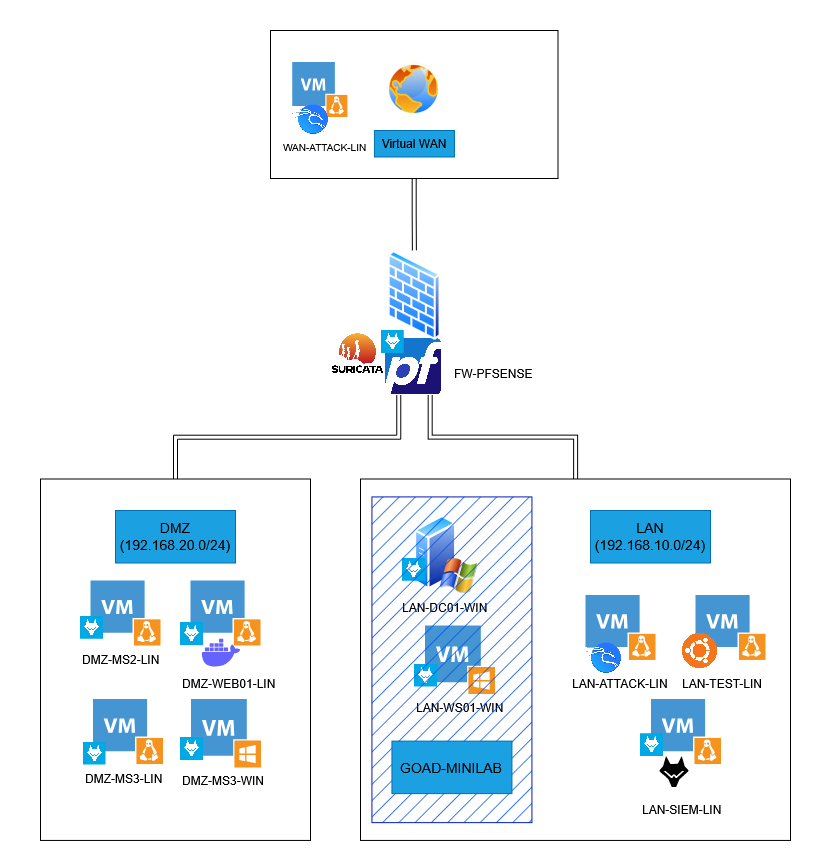
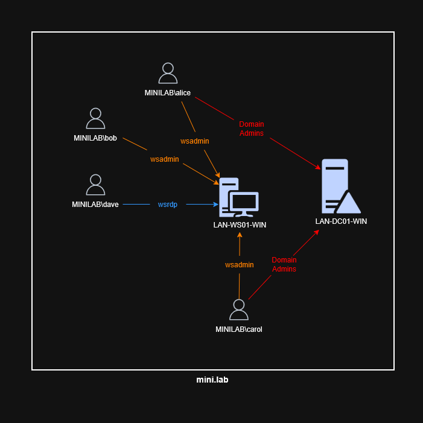

# Lab4PurpleSec - Lab overview

> **Lab4PurpleSec** - Hands-on attack & detection scenarios for Purple Team training  
> Version 1.0 · Author: 0xMR007 · Environment: Lab4PurpleSec Purple Team homelab

Introduction, architecture, components and firewall rules shared by all scenarios. Scenarios:
- [Scenario 1 - Web exploitation](scenario-1-web-exploitation.md)
- [Scenario 2 - Active Directory attacks](scenario-2-active-directory.md)

---

# Lab overview

This document presents a complete series of **attack and detection scenarios** designed for the **_Lab4PurpleSec_** cybersecurity homelab. These scenarios are designed to be used in a **Purple Team** context, allowing testing of both offensive and defensive capabilities of the environment.

## Document objectives

- **Demonstrate** realistic attack techniques in a controlled environment
- **Identify** detection points and monitoring opportunities
- **Document** log artifacts generated during attacks
- **Provide** recommendations to improve detection

## Structure

Each scenario follows a logical progression in the attack chain (kill-chain):

1. **Scenario 1**: Web application exploitation and reverse shell (WAN → DMZ)
2. **Scenario 2**: Active Directory attacks on the GOAD environment

Scenarios can be performed **independently** or **chained** to simulate a complete attack.

## Detection components

*Lab4PurpleSec* integrates several detection layers:

- **pfSense**: Firewall with rules (adjustable per scenario) and HTTP NAT
- **Suricata**: IDS/IPS for network intrusion detection
- **Wazuh**: SIEM for event correlation and log analysis
- **Application logs**: Nginx, Docker, Windows Event Logs

---

# Lab presentation

## General architecture

*Lab4PurpleSec* is a cybersecurity homelab simulating an enterprise environment with:

- **WAN Segment**: External network (segment on host network, Internet simulation)
- **DMZ Segment**: Demilitarized zone with vulnerable servers
- **LAN Segment**: Internal network with vulnerable Active Directory environment

_Lab4PurpleSec network architecture_

### GOAD MINILAB architecture

_Active Directory architecture (GOAD, MINILAB version)_

## Main components

### Network infrastructure

| Machine                | IP                                                                     | Description                                  |
| ---------------------- | ---------------------------------------------------------------------- | -------------------------------------------- |
| **`FW-PFSENSE`**        | LAN: 192.168.10.0/24 DMZ: 192.168.20.0/24 WAN: DHCP (bridged to the host's LAN) | Main firewall and router                     |
| **`DMZ-WEB01-LIN`**     | 192.168.20.105                                                         | Vulnerable web server with Docker & Nginx    |
| `DMZ-MS2-LIN`           | 192.168.20.104                                                         | Metasploitable2 vulnerable machine           |
| `DMZ-MS3-LIN`           | 192.168.20.106                                                         | Metasploitable3 vulnerable machine (Linux)   |
| `DMZ-MS3-WIN`           | 192.168.20.107                                                         | Metasploitable3 vulnerable machine (Windows) |
| **`LAN-DC01-WIN`**      | 192.168.10.30                                                          | Vulnerable domain controller (GOAD)          |
| **`LAN-WS01-WIN`**      | 192.168.10.31                                                          | Vulnerable Windows client workstation (GOAD) |
| **`LAN-SIEM-LIN`**      | 192.168.10.104                                                         | Wazuh Manager                        |
| **`LAN-TEST-LIN`**      | 192.168.10.100                                                         | Test machine (administration)                |
| **`LAN-ATTACK-LIN`**    | 192.168.10.109                                                         | Kali attack machine (LAN)                    |
| **`WAN-ATTACK-LIN`**    | DHCP (Bridge)                                                          | Kali attack machine (WAN)                    |

> **Note:**
>
> This document will only focus on the machines highlighted in bold.
>
> The `LAN-TEST-LIN` machine can be replaced by the attack machine to consult Wazuh.

### Services and applications

**`DMZ-WEB01-LIN`** hosts several vulnerable web applications via Nginx reverse proxy:

- OWASP Juice Shop (Node.js)
- OWASP NodeGoat (Node.js)
- OWASP WebGoat (Java)
- bWAPP (PHP)
- VAmPI (REST API)

**Active Directory Infrastructure** (GOAD):

- Domain: `mini.lab`
- Domain controller: `LAN-DC01-WIN`
- Client workstation: `LAN-WS01-WIN`

### Detection tools

- **Suricata**: Configured on pfSense, monitors DMZ and LAN interfaces
- **Wazuh Agents**: Installed on all *Lab4PurpleSec* machines (except WAN)
- **Wazuh**: Centralized SIEM collecting logs from all agents

## Firewall rules (adjustable per scenario)

### WAN → DMZ

- ✅ HTTP/HTTPS allowed (port 80/443)
- ❌ Direct access to LAN blocked

### DMZ → LAN

- ⚠️ Limited communication (can be modified for scenarios)
- ✅ Wazuh agents allowed (ports 1514, 1515)

### LAN → DMZ/WAN

- ✅ Full access allowed (for internal attack simulation)

---
